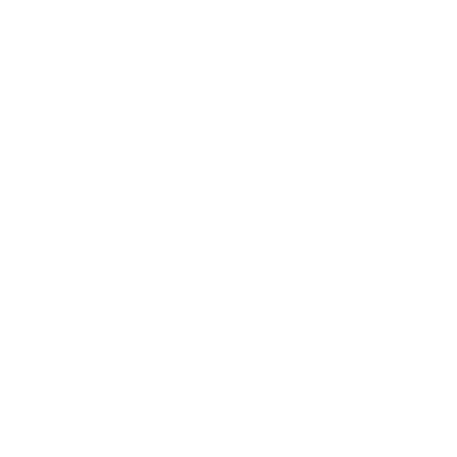

<p align="center"></p>

<h1 align="center">VEMTRIO Code</h1>

<p align="center"><b>Kendin yap. Her yerde kodla.</b><br>
VS Code tarzı kod editörü: VS Code eklentileri (Open VSX), MCP sunucuları, Emmet, terminal, canlı önizleme ve tek tıkla VEMTRIO topluluğunda paylaşım.</p>

<p align="center">
  <a href="https://github.com/y69117065-svg/vemtrio-code/releases/latest"><b>⬇ Windows için indir</b></a> ·
  <a href="https://vemtriotr.vercel.app/studio/"><b>Tarayıcıda aç</b></a> ·
  <a href="https://vemtriotr.vercel.app/topluluk">Topluluk</a>
</p>

---

## Özellikler

| | |
|---|---|
| ⌨️ **VS Code kısayolları** | `Ctrl+Shift+P` komut paleti, `Ctrl+P` dosyaya git, `Ctrl+K Ctrl+T` tema, `Alt+↑/↓`, `Ctrl+D`, çoklu imleç… Hepsi `keybindings.json` ile değiştirilebilir, akorlar (`Ctrl+K Ctrl+S`) desteklenir. |
| ⚡ **Emmet** | `!` + `Tab` → HTML iskeleti. `ul>li.kart*3`, `div#ana.kutu` gibi kısaltmalar. |
| 🧩 **VS Code eklentileri** | [Open VSX](https://open-vsx.org) pazarından ara ve kur ya da `.vsix` yükle. Renk temaları, snippet'ler ve dil ayarları çalışır. |
| 🔌 **MCP (Model Context Protocol)** | VS Code'un `.vscode/mcp.json` biçimi (Claude Desktop'ın `mcpServers` biçimi de okunur). stdio (`npx`, `uvx`, `node`…) ve Streamable HTTP sunucuları; araçları elle çalıştır ya da AI sohbetinde kullan. |
| ▶️ **Canlı önizleme** | Kaydettikçe yenilenen, internetsiz kum havuzu önizlemesi + önizleme konsolu. |
| 🖥️ **Terminal** | Gerçek PowerShell / cmd / bash terminali (masaüstü). |
| ✦ **AI sohbet** | Claude ile kod yazdır; dosyalarını okuyup yazabilir ve bağlı MCP araçlarını kullanabilir (kendi API anahtarınla, anahtar sadece cihazında saklanır). |
| 🌍 **Topluluk + Remix** | Projeni VEMTRIO topluluğunda tek tıkla paylaş; topluluktaki projeleri açıp değiştir ve kendi sürümünü yayınla. |

## İndir

[Releases](https://github.com/y69117065-svg/vemtrio-code/releases/latest) sayfasından:

- **VEMTRIO-Code-Setup.exe** — kurulum (masaüstü kısayolu oluşturur)
- **VEMTRIO-Code-Portable.exe** — kurulumsuz, tek dosya

> Uygulama henüz kod imzalı değil. Windows "Bilinmeyen yayıncı" uyarısı verirse **Ek bilgi → Yine de çalıştır** de. Kaynak kodun tamamı bu depoda.

Kurulum istemiyorsan aynı editör tarayıcıda da çalışır: **https://vemtriotr.vercel.app/studio/**

## Web ve masaüstü farkı

| | Web | Masaüstü |
|---|:-:|:-:|
| Editör, Emmet, temalar, eklentiler, kısayollar | ✓ | ✓ |
| Canlı önizleme, topluluk paylaşımı, AI sohbet | ✓ | ✓ |
| Diskteki klasörler | Chrome/Edge | ✓ |
| Gerçek terminal (npm, git, python…) | mini kabuk | ✓ |
| MCP · HTTP sunucuları | CORS'a bağlı | ✓ |
| MCP · stdio sunucuları | — | ✓ |

## Kaynaktan çalıştır

```bash
npm install
npm start          # geliştirme
npm run dist       # Windows kurulum + taşınabilir exe → dist/
```

Yapı:

```
main.js            Electron ana süreci (dosya sistemi, terminal, MCP stdio, hesap)
preload.js         Arayüze açılan sınırlı köprü (window.vnative)
app/web/studio/    Editör arayüzü — sitedeki /studio ile aynı kod
  studio-core.js   komutlar, kısayollar, komut paleti, dosya sistemleri
  studio-boot.js   çalışma alanı, editör, gezgin, terminal, önizleme, ayarlar
  studio-ext.js    Open VSX eklentileri
  studio-mcp.js    MCP istemcisi
  studio-ai.js     AI sohbet
```

## Güvenlik

- Masaüstünde dosya işlemleri sadece açtığın klasörün içinde yapılabilir.
- Önizlemeler internet erişimi olmayan, ayrı bir kum havuzunda çalışır.
- Kod çalıştıran VS Code eklentileri (extension host) etkinleştirilmez; sadece tema, snippet ve dil ayarları uygulanır.

---

<p align="center">Bir <a href="https://vemtriotr.vercel.app">VEMTRIO</a> projesi.</p>
